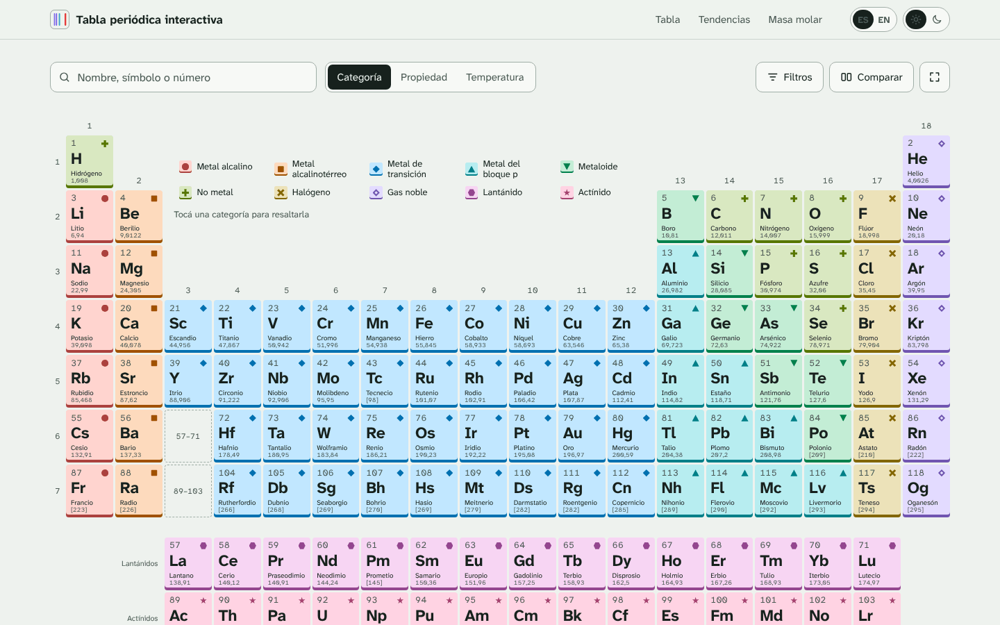
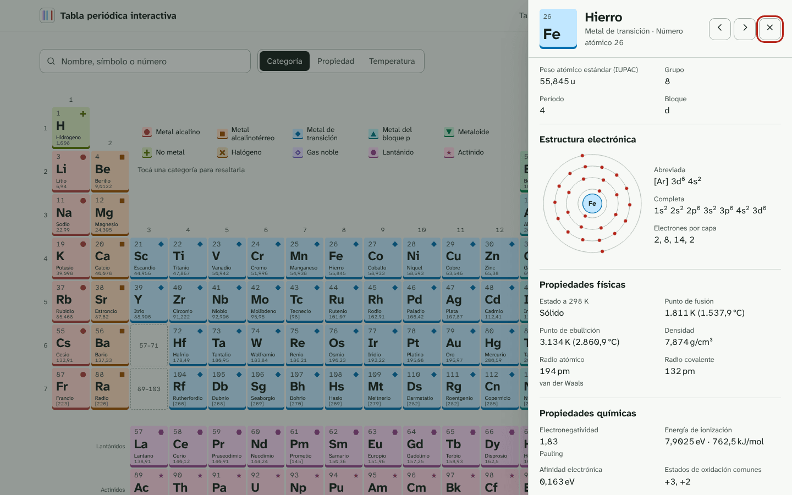
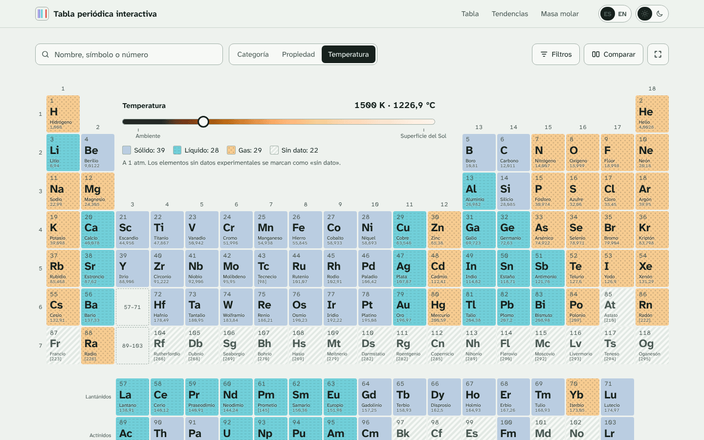
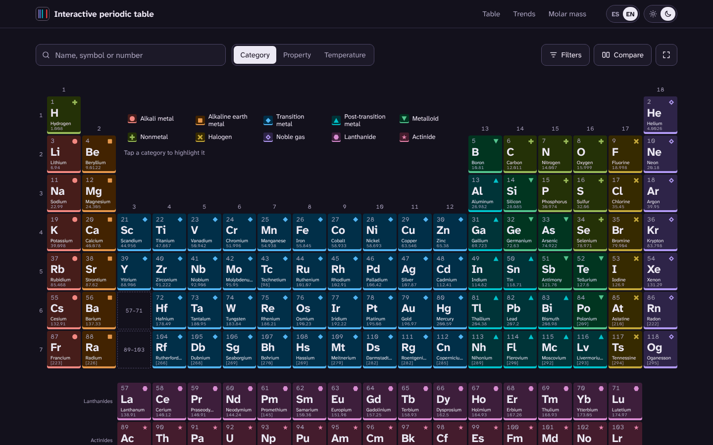
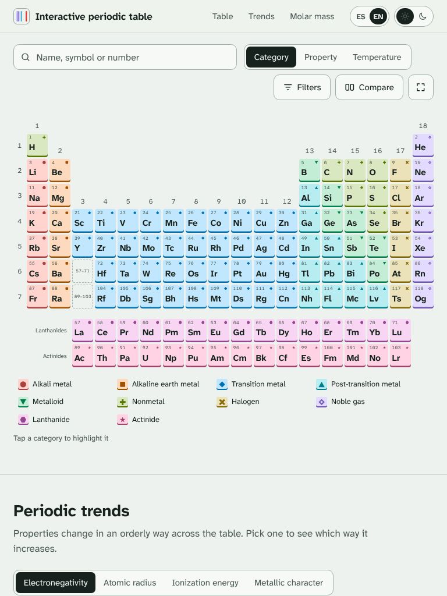
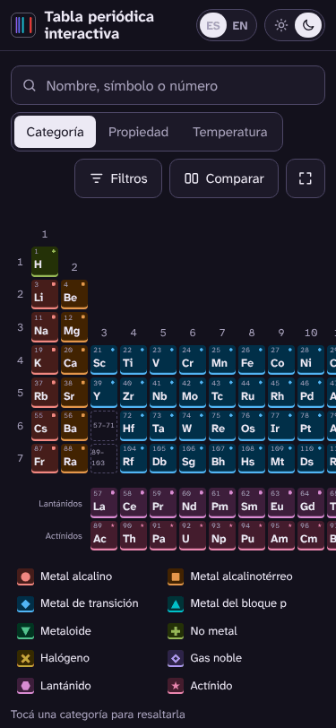
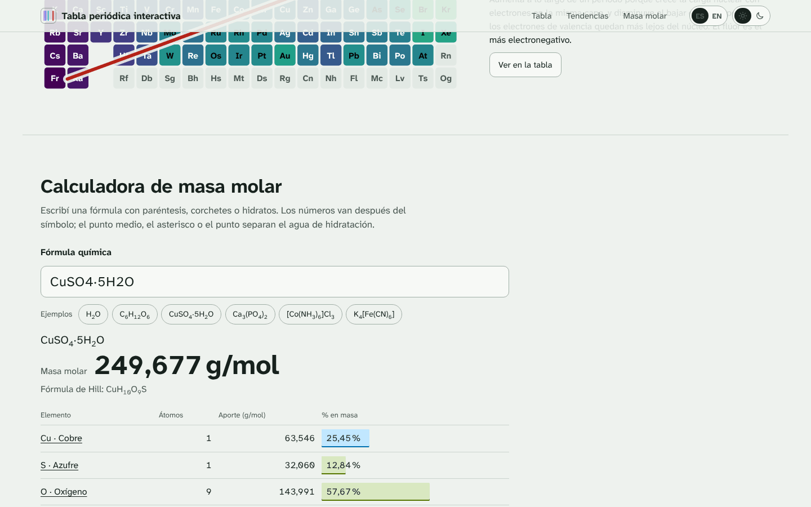

# Tabla periódica interactiva

Los 118 elementos con datos verificados contra **IUPAC (CIAAW), PubChem y NIST**, en español e inglés, con tema claro y oscuro. Funciona sin conexión después de la primera visita y se puede instalar como app.

**→ https://fer-rom.github.io/tabla-periodica/** · [English version](https://fer-rom.github.io/tabla-periodica/?lang=en)



| Ficha de elemento                                                    | Estados según la temperatura                                       |
| -------------------------------------------------------------------- | ------------------------------------------------------------------ |
|  |  |

| Tema oscuro, inglés                                                             | Tablet                                              | Celular                                                    |
| ------------------------------------------------------------------------------- | --------------------------------------------------- | ---------------------------------------------------------- |
|  |  |  |



## Qué tiene

- **Grilla de 18 columnas** con lantánidos y actínidos aparte. Cada celda muestra número, símbolo, nombre y masa. La categoría se reconoce por el color y además por un glifo, para no depender solo del color.
- **Ficha de cada elemento** con todos los datos por secciones (identidad, estructura electrónica, propiedades físicas y químicas, isótopos, historia y usos) y un **diagrama de Bohr animado**. Cada elemento tiene su propio link (`/#Fe`) y una página para compartir con vista previa en WhatsApp (`/e/fe/`).
- **Mapas de calor** de electronegatividad, radio atómico, energía de ionización, densidad (escala logarítmica), punto de fusión y año de descubrimiento. Usan la escala _viridis_, que es perceptualmente uniforme y apta para daltónicos.
- **Slider de temperatura** de 0 a 6000 K que muestra el estado de cada elemento. La pista toma el color de un cuerpo negro a esa temperatura, y cada estado tiene una textura distinta (liso, ondas, puntos).
- **Búsqueda instantánea** por nombre (en los dos idiomas y con variantes como «tungsteno» o «cinc»), símbolo o número. Tolera tildes y errores de tipeo.
- **Filtros combinables** por bloque, categoría, estado y período.
- **Comparador** de dos elementos, con el valor mayor marcado con texto e ícono.
- **Calculadora de masa molar.** Acepta paréntesis anidados, corchetes, llaves e hidratos (`CuSO4·5H2O`) y da el desglose porcentual. Ante un error, marca la posición exacta.
- **Tendencias periódicas** explicadas sobre una mini tabla con los datos reales.

## Cómo correrla

Requiere Node.js 22 o posterior.

```bash
npm install
npm run dev          # servidor de desarrollo en http://localhost:5173
npm test             # tests (Vitest)
npm run lint         # ESLint (TypeScript estricto, sin any)
npm run build        # tipos + build + chequeo del presupuesto de rendimiento
npm run preview      # sirve dist/ en http://localhost:4173/tabla-periodica/
npm run og           # imágenes de vista previa (requiere: npx playwright install chromium)
```

### Datos

```bash
npm run data:fetch   # descarga PubChem, NIST e IUPAC/CIAAW a data/raw/ (necesita internet)
npm run data:build   # normaliza, valida y genera src/data/*.json y data/sources.json
```

El build nunca depende de la red: usa el snapshot versionado de `data/raw/`. El workflow **Snapshot de fuentes** (Actions → _Run workflow_) actualiza ese snapshot y regenera el dataset.

## Cómo desplegarla

Cada push a `main` corre el workflow **CI** (`.github/workflows/ci.yml`):

1. Lint, formato, tipos y tests.
2. Verificación de que el dataset se reproduce exactamente desde el snapshot.
3. Build con chequeo del presupuesto: JS < 80 KB y total < 300 KB gzip. Si se excede, falla.
4. Generación de las imágenes Open Graph y publicación de `dist/` en la rama `gh-pages`.
5. **Lighthouse móvil** contra el sitio publicado (3 corridas por URL). Falla si alguna categoría baja de 95, si el LCP llega a 1,5 s o si el CLS llega a 0,05.

Para un fork: en _Settings → Pages_ elegí **Deploy from a branch → gh-pages / (root)**. Si el repo tiene otro nombre, ajustá `BASE_PATH` (por defecto `/tabla-periodica/`) y la URL en `vite.config.ts`.

## Fuentes de datos

Cada campo registra su procedencia en [`data/sources.json`](data/sources.json), junto con la fecha y el hash SHA-256 de cada archivo crudo.

| Dato                                                                                                                                                                              | Fuente                                                                                                                                     |
| --------------------------------------------------------------------------------------------------------------------------------------------------------------------------------- | ------------------------------------------------------------------------------------------------------------------------------------------ |
| Peso atómico estándar (abreviado) e intervalos                                                                                                                                    | [IUPAC CIAAW](https://www.ciaaw.org/atomic-weights.htm)                                                                                    |
| Isótopos: masas y abundancias naturales                                                                                                                                           | [NIST, Atomic Weights and Isotopic Compositions](https://www.nist.gov/pml/atomic-weights-and-isotopic-compositions-relative-atomic-masses) |
| Semividas e isótopo más estable                                                                                                                                                   | AMDC / IAEA, vía PubChem                                                                                                                   |
| 1.ª energía de ionización                                                                                                                                                         | [NIST Atomic Spectra Database](https://physics.nist.gov/PhysRefData/ASD/ionEnergy.html)                                                    |
| Configuración electrónica, electronegatividad (Pauling), radio de van der Waals, afinidad electrónica, estados de oxidación, estado, fusión, ebullición, densidad, año, categoría | [PubChem Periodic Table](https://pubchem.ncbi.nlm.nih.gov/periodic-table/)                                                                 |
| Radio covalente, abundancia en la corteza                                                                                                                                         | PubChem Elements (Jefferson Lab y otras fuentes que cita)                                                                                  |
| Nombres en español                                                                                                                                                                | Nomenclatura de la RSEQ/IUPAC                                                                                                              |

**Criterios:**

- Un valor desconocido o que no aplica es `null` y se muestra como «—». No se completa nada por estimación.
- Los elementos sin peso atómico estándar muestran entre corchetes el número másico de su isótopo más estable, por ejemplo [98].
- **Correcciones documentadas.** En [`data/editorial/overrides.json`](data/editorial/overrides.json) se corrigieron seis años de descubrimiento, cada uno con su fuente. Por ejemplo, PubChem marca el aluminio como «Ancient» porque el alumbre se conocía en la antigüedad, pero el elemento se aisló en 1825.
- **Textos editoriales.** Los usos, los datos curiosos y los descubridores son textos redactados a partir de las secciones de historia y usos de Jefferson Lab y Los Alamos publicadas en PubChem. Los descubridores se contrastaron automáticamente contra esos textos.
- **Muestra verificada a mano** contra los archivos crudos: H, C, O, Fe, Cu, Au, Hg, U y Og. Esos valores quedaron fijados como tests en `tests/data.test.ts`.

## Arquitectura

TypeScript estricto y JavaScript sin framework. La grilla es estática: lo que cambia es cómo se ve cada celda (mapa de calor, estado físico, filtros, selección). Por eso todo se resuelve con atributos y propiedades CSS, sin un DOM virtual que diferenciar 118 celdas.

```
data/            snapshot crudo de las fuentes, textos editoriales y procedencia
scripts/         build-data, prerender del HTML, páginas para compartir, SW, imágenes OG, presupuesto
src/data/        tipos, validación y dataset generado
src/i18n/        es.json (fuente de verdad del tipo), en.json, traductor y formato numérico
src/lib/         store, parser de fórmulas, búsqueda, filtros, escalas de color, formato
src/features/    grilla, idioma y tema, ficha, mapas de calor, temperatura, comparador, calculadora…
src/components/  diagrama de Bohr
src/styles/      tokens, base, tabla, componentes, hojas y secciones
tests/           Vitest: datos, parser, idiomas, búsqueda y filtros
```

- **LCP sin JavaScript.** La tabla se prerenderiza en el build dentro de `index.html`. El JS solo engancha eventos, con un único listener delegado.
- **Carga diferida.** La ficha, el comparador, los filtros, la calculadora y las tendencias se descargan cuando se usan. Los textos de cada idioma van en archivos separados.
- **i18n propio.** El tipo de los mensajes sale de `es.json`, así que una clave que falte en `en.json` no compila. Un test verifica que las claves de los dos archivos sean idénticas.
- **Accesibilidad.** Cumple WCAG 2.2 AA: grilla ARIA navegable con flechas, Inicio, Fin y Ctrl+Inicio/Fin; Enter abre y Esc cierra. Los switches usan `role="switch"`, el foco es visible y se respeta `prefers-reduced-motion`.

## Licencia

Código bajo licencia [MIT](LICENSE). Tipografía [Atkinson Hyperlegible Next](https://www.brailleinstitute.org/freefont/) bajo licencia [SIL Open Font License](public/fonts/OFL.txt). Los datos numéricos provienen de las fuentes citadas, que conservan sus propias condiciones de uso.
